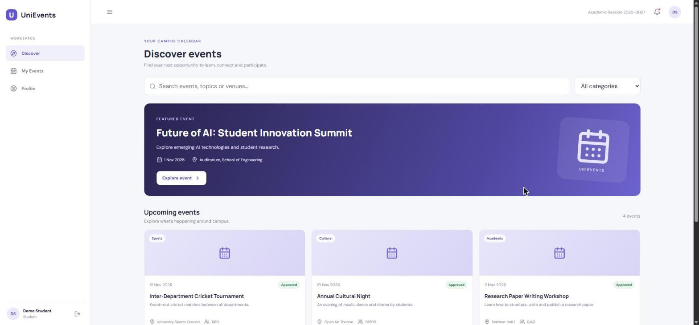
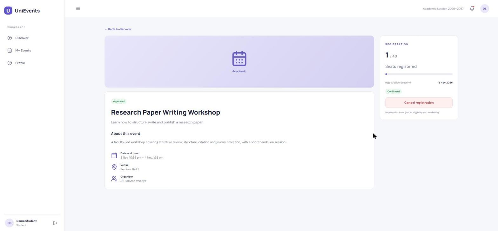
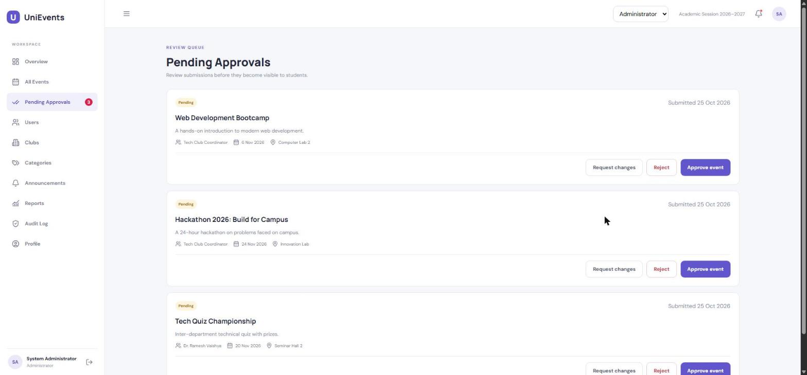
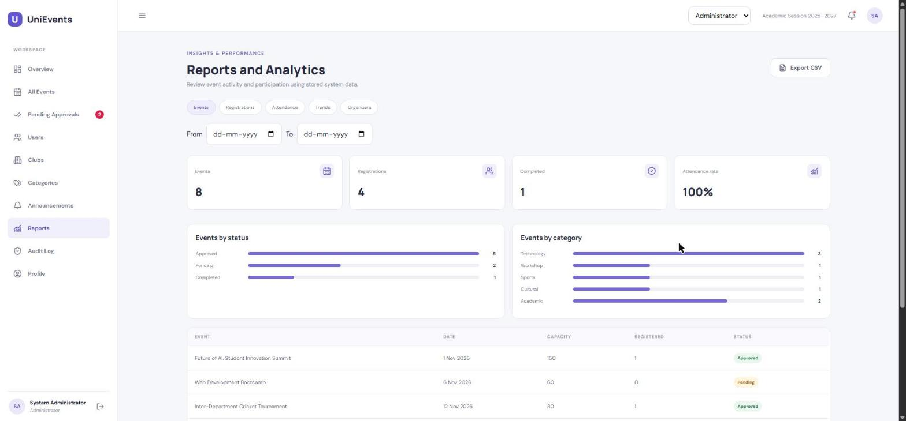

# UniEvents

A role-based university event management system designed to streamline event discovery, registrations, administrative approvals, and attendance tracking across campus communities.

**Repository:** [https://github.com/chaitanyachaurasiacse/UniEvents](https://github.com/chaitanyachaurasiacse/UniEvents)  
**Live Application:** [https://uni-events-mu.vercel.app/](https://uni-events-mu.vercel.app/)  
**Backend API:** [https://unievents-api-x514.onrender.com](https://unievents-api-x514.onrender.com/)

---

## Table of Contents

- [Overview](#overview)
- [Features by Role](#features-by-role)
- [System Capabilities](#system-capabilities)
- [Screenshots](#screenshots)
- [Technology Stack](#technology-stack)
- [Project Architecture](#project-architecture)
- [Project Structure](#project-structure)
- [Getting Started](#getting-started)
- [Environment Variables](#environment-variables)
- [Demo Access](#demo-access)
- [API Overview](#api-overview)
- [Deployment](#deployment)
- [Future Improvements](#future-improvements)

---

## Overview

In many university environments, campus event notifications and registrations are fragmented across notice boards, messaging groups, and isolated spreadsheets. This often results in scheduling conflicts, unmanaged seat capacities, cumbersome approval steps, and manual attendance logging.

**UniEvents** provides a unified platform where students, faculty members, club coordinators, and administrators interact within dedicated workflows. It enforces structured approval pipelines, atomic seat allocations to prevent over-registration, automated waitlisting, in-app notifications, and downloadable participation reports.

---

## Features by Role

### Student
- **Event Discovery:** Search events by keyword, category, and date with upcoming event filters and featured highlights.
- **Event Registration:** Register for approved events with immediate seat confirmation.
- **Waitlist Management:** Join a waitlist when capacity is reached (if enabled for the event) with automatic promotion if another attendee cancels.
- **Registration Management:** View registered and past events in a dedicated dashboard (*My Events*) and cancel registrations when needed.
- **Notifications:** In-app notification center for registration confirmations, waitlist updates, reminders, and administrative announcements.
- **Account & Profile:** Self-service registration with university domain validation, profile customization, notification preference toggles, and password management.

### Faculty Organizer
- **Event Creation & Drafting:** Create, edit, and save draft events with details including venue, dates, capacity, categories, and waitlist toggles.
- **Submission Workflow:** Submit events to the administration queue for formal review.
- **Feedback & Re-submission:** Receive change requests or rejection rationales from administrators, make adjustments, and resubmit.
- **Participant & Attendance Management:** Access real-time participant rosters, mark attendance (*Present* / *Absent*), and export participant lists to CSV.
- **Event Lifecycle Controls:** Close completed events after their scheduled end time or cancel events with mandatory student notification.
- **Organizer Analytics:** Access event performance reports, seat fill rates, and registration breakdowns.

### Club Organizer
- **Club Event Management:** Draft, manage, and submit campus events linked directly to recognized university student clubs.
- **Participant Administration:** Track registrations, manage attendance records, and export participant data.
- **Club Reporting:** View registration statistics and fill rates for club-hosted initiatives.

### Administrator
- **Approval Queue:** Review pending submissions with actions to approve, request modifications (minimum 10-character guidance), or reject with stated reasons (minimum 20-character rationale).
- **University Event Directory:** View and inspect all events across all statuses and organizer scopes.
- **User & Staff Management:** Create faculty, club, and administrator accounts; activate or deactivate user accounts with safeguards preventing the deactivation of the last active administrator.
- **Clubs & Categories Configuration:** Maintain campus club directories and manage categorized event taxonomies with custom color tags.
- **Announcements Engine:** Publish urgent or standard announcements targeted to specific roles or the entire campus.
- **System Reports & Exports:** Multi-dimensional reporting (*Events*, *Registrations*, *Attendance*, *Trends*, *Organizers*) with date filtering and CSV export.
- **Audit Logging:** Read-only log recording critical administrative and governance actions with timestamps and actor details.
- **Multi-Role Workspace Switching:** Switch between active workspaces (e.g., Admin, Faculty, Student) from the top navigation bar without re-authenticating.

---

## System Capabilities

- **Atomic Seat Allocation:** Utilizes conditional MongoDB operations (`findOneAndUpdate` with `$expr` comparison) to guarantee capacity limits are never exceeded during concurrent registration requests.
- **Automated Lifecycle & Reminders:** Background cron job (every 5 minutes) monitors event schedules to dispatch reminders (24 hours and 1 hour prior) and update event statuses (`Approved` &rarr; `Ongoing` &rarr; `Completed`).
- **Security & Access Control:** Route-level role guards, secure password hashing using bcrypt, signed JWT authentication, failed login tracking (account lock-out after 5 consecutive failures), and API rate limiting on authentication routes.

---

## Screenshots

<!-- Add interface screenshots below once captured -->

| Discover Events | Event Details & Registration |
|:---:|:---:|
|  |  |

| Approval Queue (Admin) | Reports & Analytics |
|:---:|:---:|
|  |  |

---

## Technology Stack

| Layer | Technologies |
|---|---|
| **Frontend** | React 18, Vite, React Router 7, Axios, Lucide React, Recharts |
| **Backend** | Node.js (>=20), Express 4 |
| **Database** | MongoDB, Mongoose 8 |
| **Security & Utilities** | JSON Web Tokens (`jsonwebtoken`), `bcryptjs`, `helmet`, `express-rate-limit`, `express-validator`, `node-cron`, `cors` |
| **Development Tooling** | `concurrently`, `nodemon` |

---

## Project Architecture

UniEvents follows a decoupled client-server architecture:

```
┌─────────────────────────────────┐
│     Client (React + Vite)       │
│  - React Router for navigation  │
│  - Axios with JWT Interceptors  │
│  - Session role switching       │
└────────────────┬────────────────┘
                 │ HTTP / REST (/api/*)
                 │ Headers: Authorization (Bearer JWT), X-Active-Role
                 ▼
┌─────────────────────────────────┐
│     Server (Express API)        │
│  - Security: Helmet, Rate-limit │
│  - Role verification middleware │
│  - Scheduled jobs (node-cron)   │
└────────────────┬────────────────┘
                 │ Mongoose ODM
                 ▼
┌─────────────────────────────────┐
│        MongoDB Database         │
│  - Users, Events, Registrations │
│  - Categories, Clubs, Audits    │
└─────────────────────────────────┘
```

1. **Client Tier:** A single-page application built with React and Vite. API requests are routed via an Axios instance that attaches the JWT token from `sessionStorage` and an optional `X-Active-Role` header for users with multiple assigned roles.
2. **Server Tier:** An Express application exposing RESTful JSON endpoints. Middleware handles CORS, Helmet security headers, rate limiting on `/api/auth`, payload validation via `express-validator`, and JWT authentication.
3. **Background Tasks:** An in-process `node-cron` task runs every 5 minutes to transition event states based on start/end times and generate time-sensitive notifications.
4. **Data Tier:** MongoDB stores structured documents mapped through Mongoose models with unique indexes on registrations (`event` + `student`) to enforce data consistency.

---

## Project Structure

```
UniEvents/
├── client/
│   ├── public/
│   ├── src/
│   │   ├── api.js             # Axios client instance with auth interceptors
│   │   ├── main.jsx           # App views, routing, contexts, and UI components
│   │   └── style.css          # Application styles and design system
│   ├── index.html             # Client entry HTML
│   ├── package.json           # Client dependencies and build scripts
│   ├── vercel.json            # SPA routing rewrite rule for Vercel
│   ├── vite.config.js         # Vite dev server configuration
│   └── .env.example           # Client environment template
├── server/
│   ├── src/
│   │   ├── middleware/
│   │   │   └── auth.js        # JWT verification, role authorization, and ownership guards
│   │   ├── models/
│   │   │   └── index.js       # Mongoose schemas (User, Event, Registration, Club, etc.)
│   │   ├── routes/
│   │   │   └── api.js         # Core REST API endpoint definitions
│   │   ├── utils/
│   │   │   └── core.js        # Hashing, token generation, helpers, and audit utilities
│   │   ├── index.js           # Express app setup, DB connection, and cron scheduler
│   │   └── seed.js            # Database seeding script for initial demo data
│   ├── package.json           # Server dependencies and start scripts
│   └── .env.example           # Server environment template
├── package.json               # Root scripts (install:all, dev, seed, build)
├── render.yaml                # Optional Render blueprint configuration
└── README.md                  # Project documentation
```

---

## Getting Started

### Prerequisites

- **Node.js:** version 20.x or higher
- **npm:** package manager (bundled with Node.js)
- **MongoDB:** A local MongoDB instance or a [MongoDB Atlas](https://www.mongodb.com/atlas) connection URI

### 1. Clone the Repository

```bash
git clone https://github.com/chaitanyachaurasiacse/UniEvents.git
cd UniEvents
```

### 2. Install Dependencies

Install root, server, and client dependencies using the root helper:

```bash
npm run install:all
```

Alternatively, install dependencies manually in each directory:

```bash
npm install
cd server && npm install
cd ../client && npm install
cd ..
```

### 3. Configure Environment Variables

Create `.env` files for both the server and client using the provided templates:

**On Linux/macOS:**
```bash
cp server/.env.example server/.env
cp client/.env.example client/.env
```

**On Windows PowerShell:**
```powershell
Copy-Item server/.env.example server/.env
Copy-Item client/.env.example client/.env
```

Open `server/.env` and configure your `MONGO_URI` and a random `JWT_SECRET`. Ensure `client/.env` points to your backend API URL (default: `http://localhost:5000/api`).

### 4. Seed the Database

Populate demo accounts, standard event categories, a student club, and sample events:

```bash
npm run seed
```

> **Note:** The seed script is idempotent. It will update or insert demo users and categories without duplicating existing events if events already exist in the database.

### 5. Start Development Servers

Run both the API server and Vite frontend concurrently from the root directory:

```bash
npm run dev
```

- **Frontend:** [http://localhost:5173](http://localhost:5173)
- **Backend API:** [http://localhost:5000/api](http://localhost:5000/api)
- **API Health Check:** [http://localhost:5000/api/health](http://localhost:5000/api/health)

---

## Environment Variables

### Server Configuration (`server/.env`)

| Variable | Required | Description | Example |
|---|---|---|---|
| `PORT` | Optional | Port for the Express server to listen on (defaults to 5000) | `5000` |
| `MONGO_URI` | Yes | MongoDB connection string (local or MongoDB Atlas) | `mongodb://127.0.0.1:27017/unievents` |
| `JWT_SECRET` | Yes | Secret key used to sign and verify JSON Web Tokens | `your_secure_random_string` |
| `JWT_EXPIRES_IN` | Optional | Expiration timeframe for JWT tokens (defaults to 1d) | `1d` |
| `CLIENT_URL` | Optional | Allowed CORS origin(s), comma-separated. Supports wildcards | `http://localhost:5173` |
| `UNIVERSITY_DOMAINS` | Optional | Allowed email domains for student account registration | `bbdu.ac.in,gmail.com` |
| `DEMO_RESET_LINKS` | Optional | Displays password reset link on-screen when no SMTP service is configured | `true` |
| `NODE_ENV` | Optional | Environment mode (`development` or `production`) | `development` |

### Client Configuration (`client/.env`)

| Variable | Required | Description | Example |
|---|---|---|---|
| `VITE_API_URL` | Yes | Base URL of the backend REST API (must end with `/api`) | `http://localhost:5000/api` |

---

## Demo Access

The database seed script (`server/src/seed.js`) provisions predefined accounts for evaluating role-specific workflows.

**Common Password for All Demo Accounts:** `UniEvents@123`

| Role | Email | Capabilities & Initial State |
|---|---|---|
| **Student** | `student@bbdu.ac.in` | Registered for sample events; has one attended event record. |
| **Faculty** | `faculty@bbdu.ac.in` | Event organizer; owns approved, pending, and completed events. |
| **Club Organizer** | `club@bbdu.ac.in` | Coordinator for Technology Club; owns submitted club events. |
| **Administrator** | `admin@bbdu.ac.in` | System admin with full permissions. Holds secondary `faculty` and `student` roles accessible via the workspace switcher. |

---

## API Overview

Protected routes require an `Authorization: Bearer <token>` header. Multi-role users can pass an optional `X-Active-Role: <role>` header to operate under a specific permission set.

| Group | Route | Method | Access | Description |
|---|---|---|---|---|
| **Health** | `/api/health` | `GET` | Public | Service health status check |
| **Auth** | `/api/auth/register` | `POST` | Public | Student self-registration (domain validated) |
| | `/api/auth/login` | `POST` | Public | Authenticate user and receive JWT |
| | `/api/auth/me` | `GET` | Authenticated | Fetch current user profile and roles |
| | `/api/auth/logout` | `POST` | Authenticated | Invalidate current client session |
| | `/api/auth/forgot-password` | `POST` | Public | Initiate password reset |
| | `/api/auth/reset-password` | `POST` | Public | Reset password using reset token |
| **Events** | `/api/events` | `GET` | Authenticated | Browse events with search, filter, and pagination |
| | `/api/events/featured` | `GET` | Authenticated | Retrieve featured approved events |
| | `/api/events/mine` | `GET` | Faculty, Club | View events owned by logged-in organizer |
| | `/api/events/pending` | `GET` | Admin | View events awaiting administrative review |
| | `/api/events/:id` | `GET` | Authenticated | Get event details and current user registration status |
| | `/api/events` | `POST` | Faculty, Club | Create a new event draft |
| | `/api/events/:id` | `PUT` | Owner, Admin | Update event details |
| | `/api/events/:id/submit` | `POST` | Owner, Admin | Submit event for administrative approval |
| | `/api/events/:id/approve` | `PUT` | Admin | Approve pending event |
| | `/api/events/:id/reject` | `PUT` | Admin | Reject pending event with mandatory reason (>=20 chars) |
| | `/api/events/:id/request-changes` | `PUT` | Admin | Request modifications with feedback (>=10 chars) |
| | `/api/events/:id/cancel` | `PUT` | Owner, Admin | Cancel event with mandatory notification to participants |
| | `/api/events/:id/complete` | `PUT` | Owner, Admin | Close event after end date |
| **Registrations** | `/api/events/:id/register` | `POST` | Student | Register for an event (atomic reservation / waitlist) |
| | `/api/events/:id/register` | `DELETE` | Student | Cancel registration and trigger waitlist promotion |
| | `/api/registrations/me` | `GET` | Student | View user's registration history |
| | `/api/events/:id/participants` | `GET` | Faculty, Club, Admin | View participant roster for an event |
| | `/api/registrations/:id/attendance`| `PUT` | Faculty, Club, Admin | Mark participant attendance (`Attended` / `Not attended`) |
| **Notifications** | `/api/notifications` | `GET` | Authenticated | Fetch user notifications (supports `unread=true` filter) |
| | `/api/notifications/read-all` | `PUT` | Authenticated | Mark all notifications as read |
| | `/api/notifications/:id/read` | `PUT` | Authenticated | Mark a single notification as read |
| | `/api/notifications/:id` | `DELETE` | Authenticated | Delete a personal notification (announcements protected) |
| **Admin & Config**| `/api/users` | `GET`, `POST` | Admin | List users / Create faculty, club, or admin accounts |
| | `/api/users/:id/status` | `PUT` | Admin | Activate or deactivate a user account |
| | `/api/clubs` | `GET`, `POST`, `PUT` | Auth / Admin | Manage campus student clubs (`POST`/`PUT` Admin only) |
| | `/api/categories` | `GET`, `POST`, `PUT` | Auth / Admin | Manage event categories (`POST`/`PUT` Admin only) |
| | `/api/announcements` | `POST` | Admin | Broadcast notification to selected target roles |
| **Reports & Audit**| `/api/reports/:type` | `GET` | Faculty, Club, Admin | Generate analytical report data |
| | `/api/reports/:type/export`| `GET` | Faculty, Club, Admin | Export report data as downloadable CSV |
| | `/api/admin/overview` | `GET` | Admin | System dashboard metrics and recent submissions |
| | `/api/admin/audit` | `GET` | Admin | Retrieve recent system audit logs |
| **Profile** | `/api/profile` | `GET`, `PUT` | Authenticated | View or update profile details and preferences |
| | `/api/profile/password` | `PUT` | Authenticated | Change account password |

---

## Deployment

The application is deployed across cloud platforms:

- **Frontend Application (Vercel):** [https://uni-events-mu.vercel.app/](https://uni-events-mu.vercel.app/)  
  Configured with `client/vercel.json` rewrite rules to route all traffic to `index.html` for client-side routing.
- **Backend Service (Render):** [https://unievents-api-x514.onrender.com](https://unievents-api-x514.onrender.com/)  
  Hosted as an Express Web Service with continuous health monitoring via `/api/health`.
- **Database (MongoDB Atlas):** Managed cloud cluster providing persistent storage.

> **Hosting Notice:** The backend service is hosted on a free cloud instance that enters sleep mode during periods of inactivity. If the service is idle, the initial request may take up to a minute while the instance spins up.

---

## Future Improvements

Potential enhancements identified for future releases:

- **Institutional SSO:** Integration with university SAML/OAuth2 single sign-on providers.
- **Transactional Email Service:** Integration with an external SMTP service (e.g., SendGrid, Amazon SES) for automated verification emails and password reset links.
- **QR Code Attendance Verification:** Digital ticket generation with mobile QR scanning at venue check-in.
- **Expanded Export Formats:** Native PDF summary generation and formatted Excel spreadsheet exports for institutional record-keeping.
- **Token Refresh Rotation:** Implementing dual-token authentication with refresh token rotation and explicit multi-device session management.
- **Automated Testing Suite:** Unit and integration test coverage for core API routes and user workflows.
